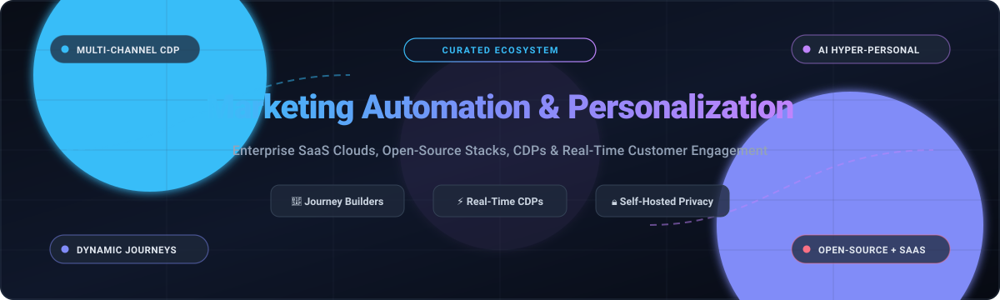

  

# Awesome Marketing Automation & Personalization 🚀 

> 🌟 A curated list of top **Marketing Automation platforms**, **Personalization engines**, and **Customer Data Platforms (CDP)** — spanning enterprise SaaS solutions and self-hosted open-source software for orchestrating multi-channel customer journeys, behavioral segmentation, and real-time hyper-personalization. 🎯

---

## 📋 Table of Contents 📑

- [📈 Sector Overview & Market Dynamics](#-sector-overview--market-dynamics)
- [🟦 SaaS / Hosted Platforms](#-saas--hosted-platforms)
- [🟩 Open-Source Software](#-open-source-software)
- [📊 Feature Comparison Matrix](#-feature-comparison-matrix)
- [🎯 Key Selection Criteria](#-key-selection-criteria)
- [💖 Support & Sponsorship](#-support--sponsorship)
- [⭐ Star History](#-star-history)
- [🤝 Contributing](#-contributing)
- [📄 License](#-license)

---

## 📈 Sector Overview & Market Dynamics 🌐

The global marketing automation software market is valued at approximately **$7.2B to $8.1B** and is projected to surpass **$20B by 2034**, growing at an estimated **12.0% CAGR** driven by AI-powered hyper-personalization, omnichannel orchestration, and customer data platform (CDP) convergence. 🚀

Market concentration follows a **moderately fragmented** structure 📊: an enterprise core of cloud giants (Adobe, HubSpot, Salesforce, Oracle) captures nearly 45–50% of top-tier enterprise revenues, while a vibrant, fragmented long tail of specialized e-commerce tools, developer-first platforms, and privacy-focused open-source frameworks commands the rest of the market. 🧩

---

## 🟦 SaaS / Hosted Platforms ☁️

The table below lists leading commercial marketing automation and personalization platforms, sorted in descending order by company scale (market capitalization / acquisition valuation / ARR). 💼

| Platform 🏢 | Type & Focus 🎯 | Scale (Valuation / Revenue) 💰 | Starting Pricing 🏷️ | Free Tier / Trial Limits ⏱️ |
|:---|:---|:---:|:---:|:---|
| **[Marketo Engage](https://business.adobe.com/products/marketo/adobe-marketo.html)** | Enterprise B2B marketing automation & lead nurturing (Adobe) | **$94.6B+** Mkt Cap (Adobe parent) / acquired at **$4.75B** | ~$1,200/mo (Select tier; billed annually via sales quote) | **No free tier**; No self-serve trial (custom enterprise demo only upon sales qualification) |
| **[HubSpot Marketing Hub](https://www.hubspot.com/products/marketing)** | Inbound marketing, email marketing & CRM suite | **~$10.6B** Mkt Cap / **$2.6B+** ARR | $15/mo/seat (Starter, billed annually) or $20/mo month-to-month | **Free forever plan** (up to 1,000 contacts, 2 CRM seats, forms, live chat & 1 email automation/form; HubSpot-branded); 14-day free trial on Pro/Enterprise |
| **[Klaviyo](https://www.klaviyo.com/)** | E-commerce email & SMS automation | **~$6.0B** Mkt Cap / **$1.47B** ARR | $20/mo (paid tier starts at 500 profiles) | **Free forever plan** (up to 250 profiles, 500 email sends/month, $5 SMS credits, email support for 60 days; Klaviyo badge required) |
| **[Braze](https://www.braze.com/)** | Mobile-first & cross-channel customer engagement | **~$5.3B** Mkt Cap / **$1.0B** ARR | ~$4,000–$5,000/mo (~$50,000/yr minimum annual sales contract) | **No free tier**; 14-day free trial available for pre-built templates, workflows, and no-code tools (no credit card required) |
| **[ActiveCampaign](https://www.activecampaign.com/)** | SMB & mid-market automation, email marketing & CRM | **~$3.0B** Valuation (Series C) / **~$250M** ARR | $15/mo (Starter plan, 1 user, 1,000 contacts, billed annually) | **No free tier**; 14-day free trial (1 user, capped at 100 contacts and 100 email sends, no credit card required) |
| **[CleverTap](https://clevertap.com/)** | Mobile app engagement, push notifications & analytics | **~$775M** Valuation (Series D) / **~$145M+** ARR | $85/mo (Core self-serve plan, up to 5,000 Monthly Active Users) | **No free tier**; 30-day free trial (self-serve Core plan access with full sandbox demo environment) |

---

## 🟩 Open-Source Software 🔓

Self-hosted, privacy-first, and community-driven tools for marketing automation, customer data platforms (CDP), web personalization, and transaction/campaign messaging. Sorted by GitHub community Stars_Count (descending). 🌟

| Project 🛠️ | GitHub_Stars ⭐ | Primary Focus & Capabilities 🎯 | Tech Stack 💻 | License 📜 |
|:---|:---:|:---|:---|:---|
| **[Twenty](https://twenty.com)** ([GitHub](https://github.com/twentyhq/twenty)) |  | Open-source CRM & customer relationship orchestration alternative to Salesforce; custom objects, workflow triggers, and segmentation. | TypeScript, NestJS, React, PostgreSQL | AGPL-3.0 |
| **[Novu](https://novu.co)** ([GitHub](https://github.com/novuhq/novu)) |  | Open-source notification infrastructure and customer communication engine across Email, SMS, In-App, Chat, and Web Push. | TypeScript, Node.js, React, Redis, MongoDB | MIT |
| **[Chatwoot](https://www.chatwoot.com)** ([GitHub](https://github.com/chatwoot/chatwoot)) |  | Customer engagement suite with live chat, omnichannel conversational routing, pre-chat lead capture, and contact segmentation. | Ruby on Rails, Vue.js, PostgreSQL, Redis | AGPL-3.0 |
| **[Listmonk](https://listmonk.app)** ([GitHub](https://github.com/knadh/listmonk)) |  | High-performance, self-hosted newsletter and mailing campaign manager; manages millions of subscribers with fast multi-threading and transactional REST APIs. | Go, PostgreSQL | AGPL-3.0 |
| **[Mautic](https://www.mautic.org)** ([GitHub](https://github.com/mautic/mautic)) |  | The flagship open-source marketing automation platform; visual journey builder, lead scoring, multi-channel campaigns (email, web, SMS), and strict GDPR compliance. | PHP, Symfony, MySQL / MariaDB | GPL-3.0 |
| **[GrowthBook](https://www.growthbook.io)** ([GitHub](https://github.com/growthbook/growthbook)) |  | Open-source feature flagging and A/B experimentation platform for dynamic web/app personalization, conversion rate optimization (CRO), and Bayesian analysis. | TypeScript, Next.js, Node.js, Python | MIT |
| **[Plunk](https://www.useplunk.com)** ([GitHub](https://github.com/useplunk/plunk)) |  | Lightweight open-source email marketing automation platform; event-driven transactional emails, dynamic broadcast campaigns, and developer API. | TypeScript, Next.js, AWS SES | AGPL-3.0 |
| **[RudderStack](https://www.rudderstack.com)** ([GitHub](https://github.com/rudderlabs/rudder-server)) |  | Open-source Customer Data Platform (CDP) core; enterprise event stream processing, real-time customer data routing, and identity stitching. | Go, Node.js, PostgreSQL | SSPL-1.0 |
| **[Dittofeed](https://www.dittofeed.com)** ([GitHub](https://github.com/dittofeed/dittofeed)) |  | Developer-friendly customer engagement and journey automation engine; version-controlled templates, event-triggered campaigns, and ClickHouse-backed segmentation. | TypeScript, Node.js, ClickHouse, PostgreSQL | MIT |
| **[SendPortal](https://sendportal.io)** ([GitHub](https://github.com/mettle/sendportal)) |  | Open-source self-hosted email marketing software; subscriber segment management, campaign scheduling, message analytics, and integration with SES, Sendgrid & Postmark. | PHP, Laravel, MySQL | MIT |
| **[Tracardi](https://tracardi.com)** ([GitHub](https://github.com/Tracardi/tracardi)) |  | API-first Customer Data Platform (CDP) and real-time behavioral orchestration engine; merges customer profiles and automates personalization rules. | Python, ElasticSearch / OpenSearch | MIT with Common Clause |
| **[Apache Unomi](https://unomi.apache.org)** ([GitHub](https://github.com/apache/unomi)) |  | Apache Foundation customer data platform and web personalization server; OASIS Context Server specification reference implementation for user profiling. | Java, Apache Karaf, OpenSearch | Apache-2.0 |
| **[Helio](https://github.com/achref-soua/helio)** ([GitHub](https://github.com/achref-soua/helio)) |  | AI-native open-source growth platform; visual React Flow journey builder, Temporal workflow orchestration, and multi-channel delivery (Email, SMS, WhatsApp). | TypeScript, Temporal, PostgreSQL, ClickHouse | AGPL-3.0 |
| **[LEO CDP](https://leocdp.com)** ([GitHub](https://github.com/trieu/leo-cdp-framework)) |  | Open-source, AI-first Customer Data Platform framework; omnichannel identity resolution, RFM predictive segmentation, and LLM-powered personalization. | Java, Python, ArangoDB, Big Data | Open Source / Commercial |

---

## 📊 Feature Comparison Matrix 🔍

| Solution 🛠️ | Deployment 🚀 | Multi-Channel Support 📱 | Visual Journey Canvas 🗺️ | Real-Time CDP / Identity 👤 | Behavioral Personalization 🎯 | Best Fit 💡 |
|:---|:---:|:---:|:---:|:---:|:---:|:---|
| **Marketo Engage** | Cloud (SaaS) | Email, Web, Mobile, Social | ✅ Yes | ✅ Enterprise | ✅ Lead Scoring / Dynamic Content | B2B Enterprise ABM & Long Sales Cycles |
| **HubSpot** | Cloud (SaaS) | Email, SMS, Web, Social, Chat | ✅ Yes | ✅ Integrated CRM | ✅ Smart Content Rules | Scaling SMBs & Inbound Growth Teams |
| **Klaviyo** | Cloud (SaaS) | Email, SMS, Push, Reviews | ✅ Yes | ✅ E-com CDP | ✅ Revenue Attribution & Product Feeds | DTC Brands & E-commerce Stores |
| **Braze** | Cloud (SaaS) | Email, Push, In-App, SMS, Web | ✅ Canvas Flow | ✅ Real-Time | ✅ AI Predictive Engagement | High-Volume Consumer Apps & Mobile First |
| **ActiveCampaign** | Cloud (SaaS) | Email, SMS, Web Messaging | ✅ Yes | ✅ Lightweight CRM | ✅ Dynamic Tags & Branching | SMBs Seeking Granular Logic at Low Cost |
| **CleverTap** | Cloud (SaaS) | Push, In-App, WhatsApp, SMS | ✅ Journeys | ✅ Real-Time Mobile | ✅ Automated Micro-Segmentation | Mobile App Retention & Lifecycle Campaigns |
| **Mautic** | Self-Hosted | Email, SMS, Web Notifications | ✅ Yes | ✅ Contact Database | ✅ Dynamic Web Content & Scoring | Data Sovereignty & Full-Featured MarTech |
| **Twenty** | Self-Hosted / Cloud | Email, Messaging, Webhooks | ✅ Workflow Builder | ✅ Unified CRM Core | ✅ Custom Record Triggers | Open Alternative to Monolithic CRMs |
| **Novu** | Self-Hosted / Cloud | Email, SMS, Push, In-App, Chat | ✅ Step Engine | ❌ (Notification Routing) | ✅ Subscriber Preferences & Digests | Engineering Teams Building In-App Comms |
| **Listmonk** | Self-Hosted | Email (Transactional & Bulk) | ❌ No (Single Campaigns) | ❌ (Mailing Lists) | ✅ Templating & Custom Attributes | Blazing Fast Newsletter & Bulk Sending |
| **GrowthBook** | Self-Hosted / Cloud | Web, Mobile, Server Experiments | ❌ (Experiment Engine) | ❌ (Warehouse Native) | ✅ Dynamic A/B Targeting & Overrides | Product Teams Optimizing Conversions |
| **Dittofeed** | Self-Hosted / Cloud | Email, SMS, Push, Webhooks | ✅ Low-Code Canvas | ✅ ClickHouse Profiles | ✅ Event-Driven Behavioral Flows | Modern Git-First & Developer Growth Stacks |
| **RudderStack** | Self-Hosted / Cloud | Event Routing to 200+ destinations | ❌ (Pipeline Router) | ✅ Real-Time Warehouse CDP | ✅ Data Activation & Identity Graphs | Composable Customer Data Infrastructure |
| **Tracardi** | Self-Hosted | Multi-channel via bridges | ✅ Visual Logic Rules | ✅ API-First CDP | ✅ Real-Time Frontend Personalization | Custom Privacy-First Customer Data Fabric |
| **SendPortal** | Self-Hosted | Email (Amazon SES, Postmark, etc.) | ❌ No (Campaign-based) | ❌ (Subscriber Lists) | ✅ Tag-based Audience Filtering | Self-Hosted Transactional & Newsletter Delivery |
| **Apache Unomi** | Self-Hosted | Web, REST API | ❌ (Rules Engine) | ✅ OASIS Context Server | ✅ Web Content Tailoring | Public Sector & Enterprise Web Portals |
| **Helio** | Self-Hosted | Email, SMS, WhatsApp, Web Push | ✅ React Flow + Temporal | ✅ Built-in CDP | ✅ AI Copilot & Conversion Scoring | Modern AI-Native Marketing Automation |

---

## 🎯 Key Selection Criteria ⚖️

When selecting between commercial SaaS platforms and open-source stacks, evaluate the following tradeoffs:

1. **Total Cost of Ownership (TCO) vs. Engineering Overhead** 💵:
   - SaaS solutions charge steeply per active profile or Monthly Active User (e.g., $1,000s/mo as contacts cross 100k+).
   - Open-source platforms eliminate contact caps and seat licenses, but require server infrastructure, database maintenance, bounce/spam IP reputation warming, and reliable worker queues (e.g., cron workers in Mautic or Temporal engines in Helio).

2. **Data Privacy & Regulatory Sovereignty (GDPR / HIPAA / CCPA)** 🛡️:
   - Self-hosted options (Mautic, Tracardi, Apache Unomi, RudderStack) allow sensitive user data to remain strictly within your sovereign Virtual Private Cloud (VPC) or on-premise infrastructure.

3. **Developer-First Integration vs. Marketer-First UI** 💻:
   - Marketer-led organizations typically prefer drag-and-drop, visual journey builders with pre-packaged integrations (HubSpot, ActiveCampaign, Klaviyo, Mautic).
   - Product and engineering teams often prefer code-first, API-driven engines with version-controlled templates and Git workflows (Novu, Dittofeed, Plunk).

---

## 💖 Support & Sponsorship ☕

Thank you so much for using and exploring this curated list! Maintaining and updating these resources takes continuous research and effort. 

If you find this repository helpful, please consider supporting the project:
- ⭐ **Star** this repository on GitHub to help others discover it.
- 🍴 **Fork** it and submit contributions, tools, or updates.
- 📢 **Share** it with your marketing, engineering, and product teams.
- ☕ **Buy me a coffee / Sponsor**: If you'd like to support the ongoing maintenance directly, please visit the [**GitHub Sponsors Dashboard**](https://github.com/sponsors/ishandutta2007). Your support is immensely appreciated! ❤️

---

## 📈 Star History ⭐

---

## 🤝 Contributing 🤝

Contributions are very welcome! If you know of an outstanding open-source Marketing Automation tool, Personalization engine, or Customer Data Platform that should be included:

1. Check that the project is actively maintained (commits within the last 12 months).
2. Follow the table format and link directly to the GitHub repository.
3. Open a Pull Request with a clear description of why the tool stands out.

---

## 📄 License 📜

This repository and curated list are licensed under the [Creative Commons Zero v1.0 Universal](LICENSE) (Public Domain Dedication). Individual software platforms retain their own proprietary or open-source licenses.

---

  Maintained with ❤️ by the open-source community. If this list helped your marketing tech stack decisions, please star the repo! ⭐

